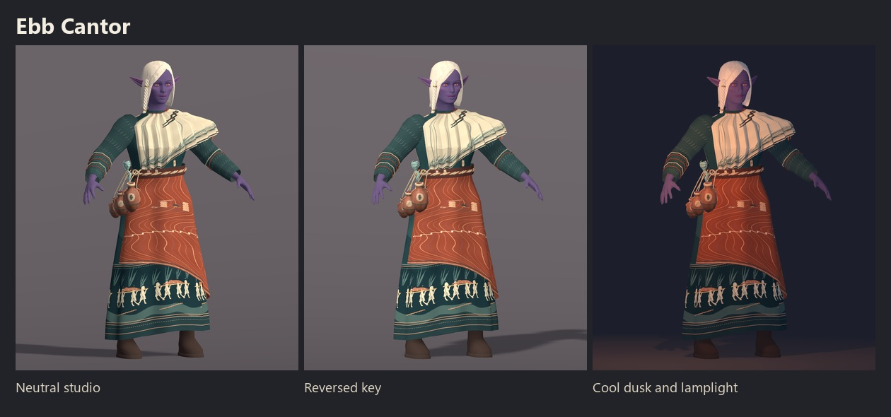

# Ebb Cantor in Unity

**Female Dark Elf · Unity 6000.5.7f1 · Built-In forward renderer · 25 November 2026**

Open the [robe review scene](../../../unity-validation/Assets/NightcapDarkElfFemale/ebb-cantor/Review/DarkElfFemale_RobeReview.unity) or drag the [dressed prefab](../../../unity-validation/Assets/NightcapDarkElfFemale/ebb-cantor/Prefab/DarkElfFemale.prefab) into an empty scene. The [Unity package](UnityReview/Ebb-Cantor.unitypackage) carries the model, flattened maps, materials, shader, prefab, scene, editor tools and Unity metadata. Rebuilding the Avatar uses the accepted female FBX already in the Nightcap validation project.

## Outfit and rig

The scene contains one character. **Nightcap → Ebb Cantor → Preview → Base** switches the same instance to the fitted shift, boots and complete skin. **Preview → Robed** restores the 16 costume pieces and hides the covered body and fitted shift. Hair, eyes, brows, modeled ears, exposed skin and boots remain visible in both states. The dressed prefab uses 32 enabled renderers. The base uses 18. The hip vessels, cut sleeves and pall are skinned to the same rig as the head and hands. [Base front](UnityReview/Base.png) · [Base rear](UnityReview/Base-rear.png) · [Base profile](UnityReview/Base-profile.png) · [Robed side](UnityReview/Side.png) · [Robed rear](UnityReview/Rear.png)

| Unity measurement | Result |
| --- | --- |
| Barefoot crown to sole | 1.700000 m. Blender measured 1.700000 m. |
| Dressed, including hair | 1.713957 m. Both boot soles contact the floor within 0.001 mm. |
| Skeleton and Avatar | 1 skeleton, 53 joints including Root, 52 Humanoid assignments matching Female_FieldHuman. Avatar Configuration verified every assigned transform. |
| Triangles | 131,488 across all switchable pieces. 109,276 dressed. |
| Skinning | 34 skinned renderers, authored UV0 and normals, normalized weights, maximum four influences. Each renderer’s bind poses and skeleton references passed. |
| Static setup | Identity prefab root, +Y up, +Z forward, file units and scale 1. Exposed skeleton, disabled Animator with Avatar, empty controller, root motion off, zero clips. |
| Bounds | Baked vertices inside each renderer’s padded bounds. The near-edge camera retained 100% of the centered silhouette pixels. |
| Play | Zero measured joint drift over 12 frames. The matched 720 × 800 Edit and Play images were identical. |

The fresh-prefab test instantiated the saved asset into an empty scene after a forced FBX reimport and checked every renderer’s material sequence against the Blender inventory. The studio scene was saved and reopened. All seven paint files and the FBX matched the source bytes. The packaged project files and metadata matched the delivered checkout. The active Unity session had the male scene open, so the automated checks ran in an isolated copy of the pinned project settings, packages, accepted female rig and shader. [Import and per-mesh audit](UnityReview/import-audit.json) · [Configure Avatar](UnityReview/avatar-configuration.json) · [Play audit](UnityReview/play-audit.json) · [Pixel and package comparison](UnityReview/comparison.json) · [Scene dependencies](UnityReview/scene-dependencies.txt)

## Material recipe

All painted materials use opaque, backface-culled **Nightcap/Painted Character**, diffuse wrap 0.35 and indirect gain 1.5. Each textured slot uses white tint and the original UV0. Constants below use sRGB hex. Standard materials use the listed metallic and smoothness settings. No tangent normal or scalar map was delivered. Tangent import is disabled. The small water figure is the only emissive slot.

| Blender slot | Base input | Unity response |
| --- | --- | --- |
| Silt / Indigo skin | Indigo-Skin, 1024² | Painted |
| Silt / Auricle paint | Auricle, 512² | Painted |
| Silt / Combed ivory | Ivory-Locks, 512² | Painted |
| Silt / Copper iris | Copper-Iris, 512² | Painted |
| Silt / Ash brows | #453A4B | Painted |
| Silt / Worn brass | #AE8653 | Standard, 0.65 metallic, 0.61 smoothness |
| Cantor / Wool and resist print | Ebb-Procession, 2048² | Painted. Includes unprinted regions used by the boots and shift. |
| Cantor / Pall and dike chart | Ebb-Pall, 2048² | Painted |
| Cantor / Madder binding | #82422E | Painted |
| Cantor / Flax cord | #B8A786 | Painted |
| Cantor / Pitch-soaked reed | #303D3B | Painted. Includes the reverse faces of the habit. |
| Cantor / Smoke fired clay | #AB6B48 | Standard, 0 metallic, 0.34 smoothness |
| Cantor / Cut slip and firing clouds | Ebb-Stoneware, 1024 × 512 | Standard, 0 metallic, 0.29 smoothness |
| Cantor / Chalk slip | #C7AE89 | Standard, 0 metallic, 0.38 smoothness |
| Cantor / Rubbed copper | #99715B | Standard, 0.45 metallic, 0.52 smoothness |
| Cantor / Condensed breath | #8FB9AD | Standard, 0 metallic, 0.64 smoothness. Emission uses linear tint × 0.12. |
| Cantor / Sealing wax | #763B32 | Standard, 0 metallic, 0.57 smoothness |

The FBX retains the source names. Unity replaces the material name’s vertical bar with an underscore at import. The build explicitly remaps those identifiers and checks each submesh in order, including multi-material cuffs and vessels. All seven albedos retain their authored dimensions, sRGB decoding, trilinear filtering, mipmaps and anisotropy 4. Desktop uses BC7. The full-frame 99th-percentile channel difference after compression was 1 level out of 255 in both the portrait and hem. [Portrait before BC7](UnityReview/Face-before-compression.png) · [Portrait after](UnityReview/Face-collar.png) · [Hem before](UnityReview/Hem-before-compression.png) · [Hem after](UnityReview/Procession-seam.png) · [Layered paint and construction sources](handoff.md)

## Camera and lighting

Linear color space, opaque forward rendering, matte floor, solid neutral camera background, no post effects or HDR. Captures use 4× MSAA and fixed exposure. The main orthographic camera looks at (0, 0.86, 0.03) from 5 m along normalized (0.58, 0.14, 1.8), with half-height 0.94 m. The three lighting frames are 800 × 920. Scene cameras are external to the character. Camera bookmarks include side, rear, face and collar, printed hem and distance. The front, side and rear orthographic axes share the full-body scale. Face and collar use half-height 0.23 m at 940 × 860. The hem uses 0.30 m at 960 × 720. The distance camera uses 4.820625 m at 960 × 720, with a measured 128 pixels from hair to floor.

| Condition | Settings and observation |
| --- | --- |
| Neutral studio | Flat ambient RGB (0.49, 0.49, 0.52), directional key RGB (1, 0.96, 0.92), intensity 1.25, direction (0.64, −0.82, −0.82), soft shadows at 0.65. The ivory bob frames the indigo cheek. The reed-green sleeve and pale pall carry different values even where their silhouettes meet. |
| Reversed key | Flip the key’s X direction to −0.64. The pall pleats, cheek and cuff change value, and the floor shadow changes side. The chart and hem figures stay registered to the skirt. |
| Dusk | Flat ambient (0.43, 0.47, 0.58). Point light at (0.65, 1.42, 0.72), RGB (1, 0.70, 0.49), intensity 1.9, range 3 m, soft shadows at 0.65. Raising the cool fill recovers the brow and far hand while the nearer cuff and vessel rack take the warm light. [Initial fill](UnityReview/Dusk-before-fill.png) · [Final fill](UnityReview/Dusk.png) |

## Visual inspection

The matched Hailstone classic and modern captures both keep the light hair separate from the dark face and the lower border visible at distance. Ebb Cantor achieves that grouping through the one-shoulder pall, diagonal madder chart and dark printed hem. The neutral Unity profile retains the Blender bob, braid, jutting ear and nose silhouette. At portrait scale the lock boundaries and angular ear rim are visible. The outer cuff stays attached to the sleeve as the light moves. The back of the pall remains visible with culling enabled. In the rear opening the dark inner fabric and boots are visible. The source’s fitted shift is hidden when dressed. [Blender profile](Review/Profile.png) · [Unity profile](UnityReview/Side.png) · [Face and collar](UnityReview/Face-collar.png) · [Rear hem and lining](UnityReview/Rear-opening.png)

The front and east skirt breadths share the procession’s carrying pole and lower dyed bands. The second detail panel marks their shared edge from projected mesh vertices. The unlit view preserves the printed rhythm, while the flat tint reveals the modeled cloth folds. These diagnostic overrides are temporary and restore every submesh material. [Marked seam](UnityReview/Printed-seam.jpg) · [Unlit hem](UnityReview/Unlit-hem.png) · [Unlit garment](UnityReview/Unlit-albedo.png) · [Flat tint](UnityReview/Flat-tint.png) · [Hip vessels](UnityReview/Vessels.png)

At 128 pixels, the pale shoulder and diagonal chart still identify the outfit from the front. From behind, the pall and narrow exposed strip of green separate the skirt from the sleeves. Individual bearers merge into a broken pale band, the vessel stamps disappear, and the water face reads as a small cool accent. Static frames establish border breakup at this scale. Motion shimmer, deformation, cloth simulation and runtime performance still need separate tests. Owner appearance review remains open. [Front at 128 px](UnityReview/Distance-128.png) · [Rear at distance](UnityReview/Distance-rear.png)

## Repeat the checks

From the character-production checkout, run `scripts/run_ebb_cantor_unity.ps1 -Stage Build`, followed by `Review`, `Avatar` and `Play` in order. The script selects the editor version from ProjectVersion.txt and writes evidence under this outfit’s UnityReview folder. Finish with `python scripts/record_ebb_cantor_unity.py` to check the packaged bytes, compare matched frames and rebuild the plates. This handoff is offline and requires no server reload or launcher update.

