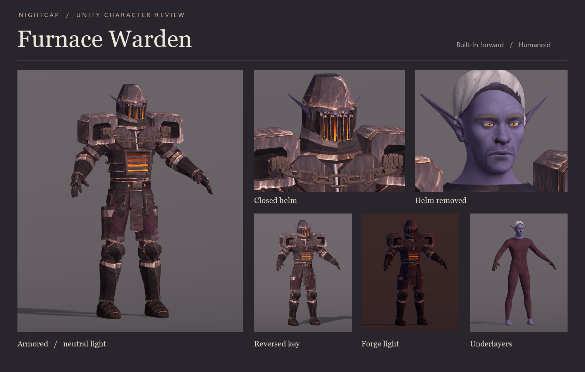

# Furnace Warden in Unity

Open [DarkElfMale_Review.unity](../../../unity-validation/Assets/NightcapDarkElfMale/furnace-warden/Review/DarkElfMale_Review.unity) in the existing Built-In validation project with Unity 6000.5.7f1. Drag [DarkElfMale.prefab](../../../unity-validation/Assets/NightcapDarkElfMale/furnace-warden/Prefab/DarkElfMale.prefab) into another scene to use the dressed character. The prefab depends on the imported model, five materials, the supplied textures, the project painted shader and the suit-local heat shader. The floor, camera and key belong to the review scene.

## Inspect the character

The scene opens in **Armored - helm on**. To compare outfits, deactivate the visible root and activate **Armored - helm off** or **Base - underlayers** in the Hierarchy. All three are instances of the same prefab. Their renderer overrides restore the hair, covered skin and four helmet pieces. Each instance has its own one-skeleton pose and shares the imported meshes and materials.

| Measurement | Blender bind | Unity skinned vertices |
| --- | ---: | ---: |
| Barefoot, crown to sole | 1.820 m | 1.819999 m |
| Equipped height | 1.857 m | 1.856999 m |
| Left / right boot sole Y | 0 / 0 m | 0.0000000 / 0.0000000 m |
| Bones | 53 | 53 |
| All / dressed triangles | 52,884 / 31,324 | 52,884 / 31,324 |

The prefab has 38 skinned renderers, five character materials, an identity root and +Z forward. The importer uses file units, scale 1, imported normals, UV0 and up to four normalized weights. Tangents are omitted for this albedo-only surface treatment. The valid Humanoid Avatar was created from the FBX with the accepted male mapping. The Avatar configuration stage resolved 52 assignments, including all 30 finger segments. The disabled Animator retains that Avatar with an empty controller and root motion off. Clip count is 0.

All 38 triangle counts and source material slots match the Blender register. Each bound mesh references the one rig in its instance. All baked vertices fell inside their renderer bounds. At the frustum edge the figure retained 100.0% of its center-frame silhouette pixels. The stopped and playing captures had a maximum RGB difference of 0 code values out of 255. [Import measurements](UnityReview/import-audit.json) · [Avatar configuration](UnityReview/avatar-configuration.json) · [Play check](UnityReview/play-audit.json) · [Image comparison](UnityReview/comparison.json)

## Paint and lighting

The skin, eyes, brows and hair use Nightcap/Painted Character. The plate and underlayer share its local Painted Heat variant. Diffuse wrap is 0.35 and indirect gain is 1.5. Textured materials have white tint, tiling 1 and offset 0. The brows retain an ash-brown tint. Emission adds painted albedo × linear mask × intensity to the existing lighting response. The shipped intensity is 0.85. [Heat disabled](UnityReview/Helm-albedo-heat.png) · [Heat enabled](UnityReview/Helm-detail.png)

| Map | Resolution | Color space | Windows GPU format | Mip levels |
| --- | ---: | --- | --- | ---: |
| DarkElf-Skin | 2048² | sRGB | BC7 | 12 |
| DarkElf-Amber | 512² | sRGB | BC7 | 10 |
| DarkElf-Ivory | 512² | sRGB | BC7 | 10 |
| Warden-Plate | 2048² | sRGB | BC7 | 12 |
| Warden-Heat | 2048² | Linear | BC7 | 12 |

All maps use trilinear filtering, clamp, anisotropy 4 and full authored resolution. Source PNGs and FBX match the Blender handoff byte for byte. The portrait was captured once uncompressed and again with high-quality compression. Mean absolute RGB difference across that frame was 0.39 / 255. [Uncompressed](UnityReview/Full-resolution-before-compression.png) · [Compressed](UnityReview/Helm-detail.png)

The review uses a matte floor at Y=0, a gray camera background, one directional key, flat ambient fill and soft shadows. The orthographic three-quarter camera targets (0, 0.925, 0.025) with half-height 1.045 m. Its direction from the target is (1.55, 0.33, 4.5), normalized. All three lighting comparisons use that camera. Fog, HDR and post-processing are off.

| Lighting | Key travel direction, normalized on use | Key RGB / intensity | Ambient RGB |
| --- | --- | --- | --- |
| [Neutral](UnityReview/Neutral-three-quarter.png) | (0.64, −0.82, −0.82) | (1, .96, .92) / 1.25 | (.49, .49, .52) |
| [Reversed](UnityReview/Reversed-key.png) | (−0.64, −0.82, −0.82) | (1, .96, .92) / 1.25 | (.49, .49, .52) |
| [Forge](UnityReview/Forge.png) | (.94, −.42, −.36) | (1, .61, .35) / .85 | (.28, .33, .43) |

## Visual review

The square shoulders and barred hood carry the silhouette at distance. The chest shutters keep their orange separation, while individual links and fine wear merge at 128 pixels. In the close-up the amber eyes sit behind the shelf, the ears clear the hood, and the orange falls behind the dark bars. With the helmet removed, the ivory hair and violet cheek separate from the collar. The armor reads more angular and its wear more mottled than the concept. The bind pose also holds the arms wider. [Concept, Blender and Unity](UnityReview/Scale-and-paint.png) · [960 × 720 distance frame](UnityReview/Distance-128.png) · [Reversed key](UnityReview/Reversed-key.png)

[Front](UnityReview/Front.png) · [Side](UnityReview/Side.png) · [Rear](UnityReview/Rear.png) · [Helm off](UnityReview/Armored-helm-off.png) · [Uncovered portrait](UnityReview/Uncovered-head.png) · [Grazing profile](UnityReview/Head-profile.png) · [Base](UnityReview/Base.png) · [Base rear](UnityReview/Base-rear.png)

The source-matched unlit camera uses Blender's 670 × 850 framing. The two silhouettes overlap by 99.74% intersection over union. Within their common foreground, the median absolute RGB channel difference is 1 / 255. Silver wear on the hood, orange shutters and asymmetric tasset marks retain their orientation. [Blender unlit](Review/Unlit-color.png) · [Unity unlit](UnityReview/Unlit-Blender-match.png)

## Reproduce

The project wrapper runs four editor stages, Build, Review, Avatar and Play. Build recreates the assets. Review reimports and measures the saved model and scene and captures the shots. Avatar opens Unity's configuration stage, checks its assignments and returns to the review scene. Play compares the default state in Edit and Play modes. The Python handoff script compares the captures, source checksums and per-renderer counts. [Wrapper](../../../scripts/run_furnace_warden_unity.ps1) · [Handoff check](../../../scripts/warden_unity_handoff.py)

The final build, reimport, Avatar and Play checks completed without an error attributable to the character. Meshes, materials, shaders and textures resolved after reopening. The raw editor logs are retained locally under `character-production/evidence/diagnostics/furnace-warden-unity/`. The accepted local human FBX supplied the mapping and scale conventions. [Unity model settings](https://docs.unity3d.com/6000.0/Documentation/Manual/FBXImporter-Model.html) · [Unity rig settings](https://docs.unity3d.com/6000.0/Documentation/Manual/FBXImporter-Rig.html)

Blender input SHA-256 is `4f5317b2b4f6c44d2e34baf90ed59c21d9621149e5d6c6160a3ef50c2c9552ef`. FBX input SHA-256 is `8a8c5244f99b93f8184b17dfebe35c5cf2dd401cb44921b328c25d070b279868`. The validation covers this static character in Unity. Gameplay integration, animated deformation and populated-scene performance remain separate milestones. [Blender handoff](handoff.md)
